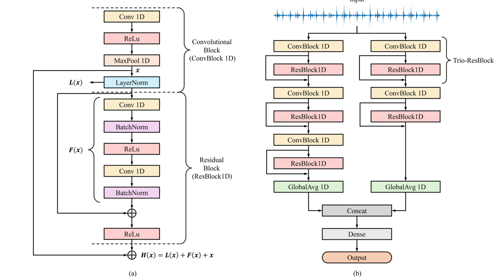
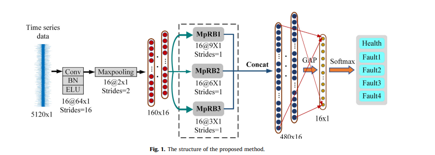
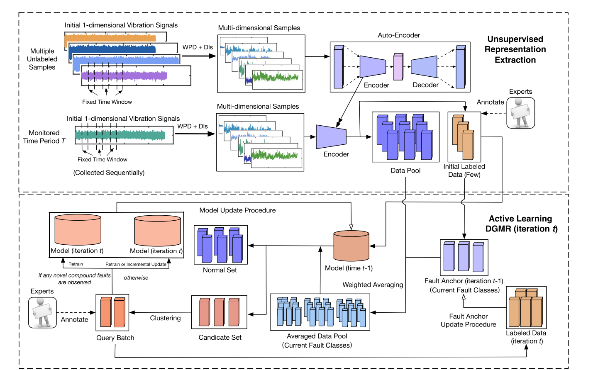
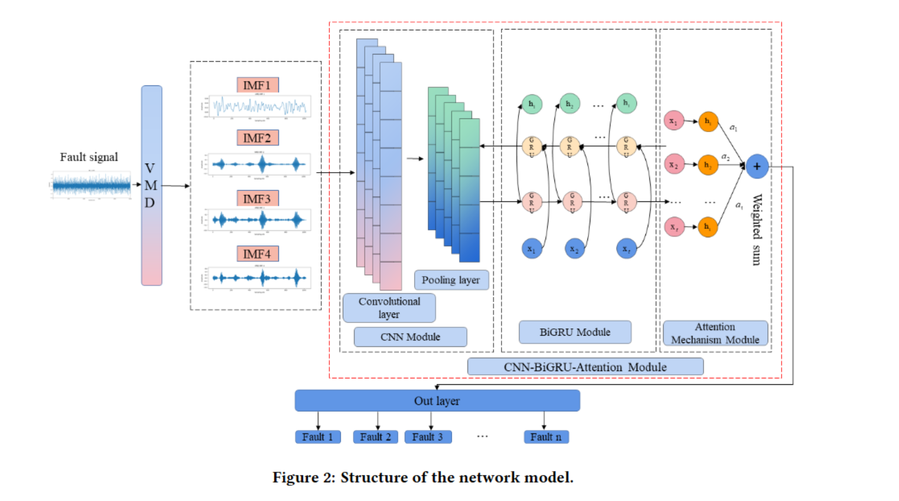

### SOTAmodel：

1.DPTRCNN:Real-time intelligent bearing fault diagnosis based on dual path three-folded residual network

Q3:The International Journal of Advanced Manufacturing Technology date：2025/7/21

problem：当前的深度学习模型在面向实时监测条件的应用中仍面临挑战。1.深度学习模型在实时条件下的评估不可靠，导致智能实时故障诊断应用困难，因为很难基于训练时间来界定模型的响应性。2.广泛应用于机械故障诊断系统中的卷积神经网络（CNN）在采用单一卷积核时存在局限性。

solution：因此，本文提出了双路径三折残差网络（DPTTRCNN）。不同尺度的并行路径能够获取不同维度的特征。



组件：双路径1dcnn+redeciual

conclusion：

开展了实时故障诊断仿真，并从数据加载、数据分割和数据预测三个方面评估了每秒钟数据的响应时间。通过分析，所提出的DPTRCNN模型在故障诊断中表现出色，每种情况的平均准确率均达到99%。根据基于每秒钟数据段平均预测时间的深度学习模型响应时间分析，深度学习模型总体上具有即时响应能力，每次预测时间小于250毫秒。然而，基于实时故障仿真与实时监测条件在数据加载时间和数据分割时间方面的比较，由于系统内部交互，实时故障诊断中的延迟是不可避免的。在实时故障诊断应用中，每个功能处理时间都会增加系统处理和显示结果所需的时间，尤其是预测时间。在未来的分析中，将基于实验数据集开展实时故障诊断，以进一步评估深度学习模型在实时条件下的性能。


keyword：FDD（fault detection and diagnosis）RTFD（realtime fault diagnosis）

### citation：


被：

Q2:measurement date:2026

>Fault identification for intelligent real-time monitoring via mobile accessible networks: a critical review of MEMS microphone-based sensing for bearing diagnostics

主：

使用时频域：An introduction to condition-based maintenance

​		Review of condition monitoring of rolling element bearing using vibration analysis and other techniques.

​		Time and frequency domain analysis of signals: a review.			

使用cnn：

Integrated thermal error modeling and compensation of machine tool feed system using subtraction-average-based optimizerbased CNN-GRU neural network.

使用lstm：

 A novel method for bearing fault diagnosis based on BiLSTM neural networks. 

使用ae：

Ball bearing multiple failure diagnosis using feature-selected autoencoder model. 

rtfd：Real-time fault diagnosis and fault-tolerant control.

rtfd method：1.遗传算法优化提升树（GABoT）基于遗传算法对模型进行优化-》为经证实的指标

GABoT: a lightweight real-time adaptable approach for intelligent fault diagnosis of rotating machinery

2.结合海洋捕食者算法优化的LightGBM方法，将特征和向量减少高达85%，使模型能够有效应用于实时预测。

Real-time adaptable fault analysis of rotating machines based on marine predator algorithm optimised LightGBM approach

3.对一维CNN应用贝叶斯优化，使测试时间从平均0.1886秒降至平均0.1464秒

4....

这群人都在用不正确的时间去比

cnn被证明表现最显著：

传统的：问题：过拟合，梯度消失-》残差网络

残差块加lstm

A novel hybrid model integrating residual structure and bi-directional long short-term memory network for tool wear monitoring

MSDF-DSRNet也有残差块

Train bearing fault diagnosis based on multi-sensor data fusion and dual-scale residual network. Nonlinear Dyn 111(16)

多尺度：

1.Traffic sign recognition with multi-scale convolutional networks. 

2.A tool wear monitoring and prediction system based on multiscale deep learning models and fog computing. 

3.Multi-scale quadratic convolutional neural network for bearing fault diagnosis based on multi-sensor data fusion

***

i.Fault identification for intelligent real-time monitoring via mobile accessible networks: a critical review of MEMS microphone-based sensing for bearing diagnostics

这tm是个survey

conclusion：

  对可靠、可及、经济高效的非接触式传感日益增长的需求，加速了旋转机械轴承智能状态监测的进步。本综述强调，状态监测（CM）的近期进展通过集成先进信号处理、人工智能（如机器学习方法），并使用MEMS麦克风作为非接触式传感、自供电传感器和边缘计算，实现了增强的故障诊断。MEMS麦克风具有多项实际优势，包括非接触测量、低成本、紧凑尺寸、易于与移动设备集成、可及性以及适合连续实时监测。此外，这些技术提高了诊断准确率、实时监测能力以及对变化工况的适应性。然而，仍存在若干重要挑战，包括从**嘈杂工业环境中提取微弱故障特征的困难、超出实验室数据集的验证有限、高计算需求、传感器部署以及长期能源可持续性**。

本综述采用系统性文献综述方法，批判性分析智能轴承故障诊断的近期发展。比较分析表明，先进信号处理技术在特征提取和分类中发挥关键作用，例如**快速傅里叶变换（FFT）、小波变换（WT）、经验模态分解（EMD）和变分模态分解（VMD）**。此外，**深度学习、迁移学习、生成对抗网络（GAN）、Transformer架构和图卷积网络（GCN**）的近期进展，通过实现自动特征学习和变化工况下的稳健故障分类，显著提高了诊断准确率。尽管有这些进展，文献仍揭示了若干持续存在的挑战。批判性分析表明，在传感模态技术进步、有限实验条件下的算法成功、计算时间以及真实工业应用中的可靠运行之间，存在明显差距。

本综述支持通过移动可访问网络进行智能实时监测的轴承诊断故障识别的未来研究。所提出的框架集成了低成本MEMS声学传感、自适应信号处理、智能特征学习、边缘人工智能和基于智能手机的移动网络，以实现可及、实时且可扩展的轴承健康评估。因此，未来研究应聚焦于**开发低成本、可及且自适应的监测系统，结合噪声鲁棒性、先进信号处理、智能可及传感和嵌入式人工智能**。这一概念为旋转机械提供了一个有前景的框架，通过将自适应传感、边缘智能计算和实时运行集成到一个易于部署的平台中，弥合实验室规模研究与实际工业部署之间的差距。

2.MSC-MpResCNN (Multiscale Cascade Midpoint Residual CNN)：*A novel convolutional neural network with multiscale cascade midpoint residual for fault diagnosis of rolling bearings*

date：2022

problem：卷积神经网络（CNN）已广泛应用于机械故障诊断系统，并取得了令人满意的结果。网络层数和单一固定卷积核的一些局限性也随之暴露出来。

solution：




被：

1.A novel intelligent diagnosis method of rolling bearing and rotor composite faults based on vibration signal-to-image mapping and CNN-SVM

q2：**measurement** date 2023

2.Deep residual convolutional neural network based on hybrid attention mechanism for ecological monitoring of marine fishery

3.A frequency channel-attention based vision Transformer method for bearing fault identification across different working conditions

4.A discrimination-guided active learning method based on marginal representations for industrial compound fault diagnosis

q2：**IEEE TRANSACTIONS ON AUTOMATION SCIENCE AND ENGINEERING** date：2024

主：

...太久了就算了

***

4.A discrimination-guided active learning method based on marginal representations for industrial compound fault diagnosis

problem：

复合故障的特征应被充分考虑。因此，合理引入故障信息的先验知识对于提升诊断方法的实用性具有重要意义。

solution：




## citation

被：

Multi-mode fault diagnosis datasets of gearbox under variable working conditions

date 2024 q3

Multi-condition fault diagnosis of dynamic systems: A survey, insights, and prospects

date2025 q2 **IEEE Transactions on Automation Science and Engineering**

> 这tm也是个survey

A systematic review of diagnosis methods for rolling bearing compound faults: research status, challenges, and future prospects

date2025  


3.MCL-DRL (Multiscale CNN-LSTM and a Deep Residual Learning model)date：2023/q2:**MEASUREMENT SCIENCE and TECHNOLOGY**

An anti-noise fault diagnosis approach for rolling bearings based on multiscale CNN-LSTM and a deep residual learning model


## citation

1.Attention-based ConvNeXt with a parallel multiscale dilated convolution residual module for fault diagnosis of rotating machinery date2024 q1**expert system with applications**

2.Fault diagnosis of electric motors by a channel-wise regulated CNN and differential of STFT;date 2025

3.Bearing fault diagnosis under heavy noise: A multi-scale dilated convolution and dense temporal convolutional network

date 2025

4.Marine diesel engine piston ring fault diagnosis based on LSTM and improved beluga whale optimization

date2024

5.Diesel engine fault diagnosis for multiple industrial scenarios based on transfer learningdate2024

6.Bearing fault diagnosis based on CNN-BiLSTM and residual module;date2023

7.Bearing fault diagnosis with parallel CNN and LSTM;date2024

8.A novel convolutional neural network with global perception for bearing fault diagnosis;date2025

9.Multi-source heterogeneous information fusion fault diagnosis method based on deep neural networks under limited datasets;date2024

***

1.Multi-source heterogeneous information fusion fault diagnosis method based on deep neural networks under limited datasets;date2024


## citation

被：1.Bearing prognostics and health management based on hybrid physical mechanism and data models: a systematic review

2.Adaptive fault diagnosis of railway vehicle on-board controller with large language models

3.A review of deep learning in rotating machinery fault diagnosis and its prospects for port applications

4.Research, application, and challenges of causal inference in industrial fault diagnosis: A survey

***

Bearing prognostics and health management based on hybrid physical mechanism and data models: a systematic review

## citation

1.An improved variational autoencoder and graph attention network method for wear prediction of aerospace self-lubricating bearing using acoustic emission signal date：2026

2.MTCAT: a modern temporal convolution and enhanced attention transformer model for remaining useful life prediction of aerospace self-lubricating bearings date：2025

3.A hybrid physical damage neural network for wear prediction of self-lubricating bearings

***

2.Attention-based ConvNeXt with a parallel multiscale dilated convolution residual module for fault diagnosis of rotating machinery

problem:强噪声适用性有限


4.AMPCNN (parallel CNN architecture with attention mechanism)

## citation

5.Parallel 1D-CNN / Improved Parallel 1D-CNN

*A rolling bearing fault diagnosis method based on an improved parallel one-dimensional convolutional neural network*

## citation

6.**Compact 1D CNN**

*Rolling Element Bearing Fault Detection and Diagnosis with One-Dimensional Convolutional Neural Network*

7.VMD + CNN-BiGRU-Attention（date2025）

Bearing fault diagnosis based on VMD-CNN-BiGRU-Attention

problem：改善了传统方法以人工特征为中心以及现有模型在多尺度特征融合和时序建模方面的不足

solution：




conclusion:

传统故障诊断方法依赖人工特征、抗噪性差、泛化能力弱的局限性，通过融合多尺度信号处理与深度学习技术，提出了一系列创新性解决方案：依托VMD技术将原始信号转换为二维时频图和关键IMF分量，结合CNN与BiGRU实现从信号预处理到特征表征的全流程自动化，避免了对传统人工特征的依赖。通过交叉对比实验和多维度指标验证（混淆矩阵、t-SNE聚类），证明了所提方法优于现有模型。该系统解决了传统故障诊断中存在的信息丢失、人工依赖和场景适应性难题，为工业设备的预测性维护和无人系统的智能决策提供了高度可靠的算法支撑。

```c++
// this is a solution cube
/*
读到现在发现，很多都是1dcnn，然后又因为cnn的缺陷加了多尺度+残差机制
再缝合的就是把信号处理+cnn+bigru<时序建模>
>理解错了，这里信号处理之后就变成一个二位图了，这是另外的方法了。
*/
```

## citation

