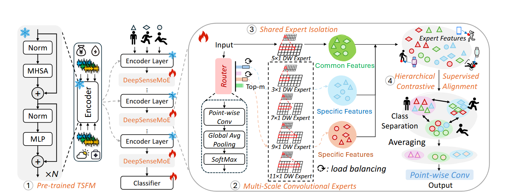

# DeepSenseMoE: Harnessing Power of Time Series Foundation Models for  Few-Shot Human Activity Recognition

## 摘要

Recent advances in Time Series Foundation Models (TSFMs) have fundamentally revolutionized general time series analysis across domains like finance, ==retail==, weather, and power.

最近在时间序列基础模型已经从根本上地革命了一般地时间序列分析从经济，铁路，天气，能源等领域，

> retail 零售

However, how to unlock the hidden capacity of ==generalpurpose==  TSFMs for wearable activity recognition still remains largely unexplored, given severe sensor annotation scarcity and highly heterogeneous sensor data.

但是，如何解锁通用的TSFM在可穿戴地活动识别方向封藏地能力仍然很大程度地没有被探索，因为许多地传感器注释缺乏并且高度不同的传感器数据

> generalpurpose通用的；多功能的；非专用的

To address these challenges, we propose DeepSenseMoE—a novel multi-scale convolution-based Mixture of Experts (MoE) module for parameter-efficient fine-tuning of general-purpose TSFMs to sensor-based activity recognition.

为了解决这些挑战，我们提出了DeepsenseMoE，一种新的多尺度卷积基础的混合专家模型针对通用的TSFMs参数效率微调到基于传感器的活动识别。

DeepSenseMoE integrates three key innovations: (1) Multi-scale convolutional experts with different filter sizes responsible for capturing varying sensor contexts; (2) Shared-expert isolation mechanism compressing common activity knowledge into a single shared expert while reducing redundancy among routed experts; and (3) Hierarchical supervised contrastive alignment guiding experts to further learn discriminative activity features. Extensive experiments on three challenging HAR benchmarks demonstrate DeepSenseMoE’s superiority, achieving up to 9.5% accuracy gains over state-of-the-art under few-shot and full-supervised settings, with only <1% additional trainable parameters.

deepsenseMoE集成了三个核心创新点（1）多尺度卷积专家拥有不同的filter尺度，复杂捕捉变化的传感器上下文。（2）分享的专家独立机制挤压普通的活动知识进一个单个分享的专家当减少冗余度在分路的专家中，（3）分等级的监督的对比研究的排成直线的引导专家去进一步学习辨别活动特征。广大的实验在三个挑战HAR基准，说明了deepsenseMoE的优先级，获得了超过9.5%的准确率，在几次教学和全量监督设定，只有小于1%的额外训练数据。

We hope that this work may lay a solid foundation to accelerate development and deployment of powerful TSFMs in data-scarce wearable activity recognition tasks while reducing the reliance on labeled sensor data.

我们希望这个工作能建立了一个稳定的基础去加速TSFMs的发展和部署在数据规模易于穿戴的1活动任务在减少对于标记的传感器数据的依赖。

## 1 Introduction

During the past decade, human activity recognition (HAR) has garnered significant attention

在过去的十年里，人类活动识别一直收集者重要的注意力

> garner收集

It leverages a variety of sophisticated deep learning models including Convolutional Neural Networks (CNNs), Recurrent Neural Networks (RNNs), and Transformers to analyze and infer human activities through wearable sensors attached to different body locations, offering a wide range of real-world applications like health management, fitness tracking, sports performance analysis, and gesture recognition (Chen et al. 2021).

它充分利用了一系列复杂的深度学习模型，比如卷积神经网络，循环神经网络，transformer去分析和推断人类活动通过可穿戴的传感器，贴在身体不同的部位，提供一个广泛范围的真实世界应用例如健康管理，和适度追踪，运动表现分析和动作识别

In essence, sensor-based activity recognition can be seen as a multivariate time series classification task.

从本质上来说，传感器基础的活动识别可以被看做一个多变量时间序列分类任务

Recently, inspired by outstanding success of foundation models (FMs) in modalities like text and image (Awais et al. 2025; Min et al. 2023), the concept of time series foundation models (TSFMs) has emerged as a new research direction, which aims to harness the potential of FM paradigm by leveraging large-scale time series datasets to learn generalizable representations across a multitude of general time series tasks like finance, power, weather, and health (Das et al. 2024; Zhou et al. 2023; Goswami et al. 2024).

最近，受基础模型的杰出成功，在文本和图像，时间序列基础模型已经涌现成为一个新的研究方向，目的就是为了驾驭FM的潜在范式，通过使用大规模的时间序列数据集来学习一般性的代表通过一个多管道的一般时间序列任务像金融，能源，天气，健康。

Despite promising potential of TSFMs, we notice that this evolution seems mostly limited to general time series tasks (e.g., stock prices for different companies or weather data from various locations), and has been notably absent in the field of HAR.

尽管TSFM的前景潜力，我们注意到这场进化似乎主要限制于生成一般的时间序列任务，像不同公司股票价格，不同地区的天气数据和已经在值得注意的缺席在HAR领域

Now, there are still two ongoing challenges that severely hinder the development of foundation model paradigm in wearable activity recognition: 1) Sensor annotation scarcity.Though huge amounts of multivariate sensor readings are being produced by wearable devices, labeling sensor data is harder than labeling image or text, which requires an annotator to meticulously annotate sensor readings. While it is easy to distinguish a picture of a dog from a cat instantly, telling subtle differences between IMU sensor signals for upstairs and downstairs may be challenging. This is a tedious and time-consuming process, causing severe sensor annotation scarcity. Thus, most publicly available HAR datasets remain small in scale; 2) High heterogeneity in sensor data. Wearable sensor data is highly heterogeneous. Given multiple sensor devices and varying onbody recording locations, their resulting distributions may be astonishingly diverse (Chen et al. 2021). Even the same actions recorded at identical sensors and locations but with different persons also produce vastly different sensor readings, due to respective behavior patterns. Although numerous small-scale HAR datasets have been released, they are mostly gathered under different sensor settings and collection protocols including various sensor modalities (e.g., accelerometer, gyroscope, and magnetometer), body locations (e.g., wrist, arm, leg), subject-variability (e.g., men, women, elderly, children), which remain highly diverse or heterogeneous in dataset structure (i.e., distribution).

现在还有两个正在遭受的许多阻碍fm在活动识别范式的挑战1）传感器标注缺乏，尽管大量数据据的多种类传感器阅读是可穿戴设备制作的，标记数据比标记一个图像和文本困难的多，需要一个标记器去一丝不苟的去编辑传感器数据，尽管很容易去判别一个狗和猫的图片，发现微妙的区别在IMU传感器信号从底层到高层要难的多，这是一个冗长的并别消耗时间的过程，导致许多传感器注释区别，所以大多数公开的HAR数据集尺度都非常小，2）传感器数据的属性的高度不同，可穿戴的传感及数据是高度不同的，多个传感器设备和变化的身体上的不同标记位置，他们导致分本可能非常的多元，甚至相同的动作识别在一个相似的传感器和位置上，但是不同的人通常产生非常不同的传感器数据，由于他们不同的表现。尽管大量的小尺度HAR数据已经被发布，它们大多数，是用不同传感器设定，不同协议收集而来的的，这让数据非常的不同。

Given that the two major challenges persist, the current HAR research still remains highly fragmented in the absence of common standardization across small-scale datasets. On one hand, the lack of massive and unified datasets makes it impractical to train activity foundation models from scratch. On the other hand, most existing TSFMs are often pretrained for general-purpose time series tasks, not customized for activity-specific domain (Das et al. 2024). This creates a crucial gap: Can we harness the power of existing TSFMs pre-trained from general data-rich time series datasets tailored to wearable sensor stream for data-scarce activity recognition tasks? To close the gap, in this paper, we make the first attempt to leverage existing TSFMs pretrained from data-rich general time series datasets, and adapt them to activity-specific tasks with scarce and heterogeneous sensor data. Figure 1 illustrates the motivation behind our work. However, the majority of previous TSFMs are closed-source, resulting in limited access to the model itself. Therefore, in this paper, we mainly focus on the first family of open-source TSFM namely MOMENT (Goswami et al. 2024), and fine-tune it with activity-related knowledge.

有这两项主要挑战坚持着，现在的HAR研究仍然在普遍标准在不同小规范的数据集没有的情况下，保持着高度的脆弱。一方面，大量的通用领域数据集缺席是的训练活动基础模型从头构建不现实，另一方面，大部分已经存在的TSFM通常为通用的时间序列任务预训练不是定制于具体活动领域的，这创造了一个重要的坑，我们可以驾驭现存TSFM的预训练的能力吗并且适到可穿戴的传感器流到数据缺乏的活动识别任务吗？为了填上这个坑，在这篇文章中，我做了第一次尝试，去使用现存的TSFMs并且使用到缺乏的数据高度不同的传感器数据，图一说明了我们工作背后的动机，然而大量的先前TSFM是闭源的，导致了我们接触不到模型本身，所以在这篇论文，我们主要专注于第一家族的开源TSF,叫做MOMENT并且微调他使用活动相关的知识。

Since wearable sensor data is highly scarce and heterogeneous, direct usage of MOMENT will considerably underperform under data-scarce scenario, due to lacking homogeneity between general time series datasets and activityrelated target datasets. To empower general-purpose MOMENT with strong activity sensing capability, a straightforward strategy is to fine-tune it on downstream activityspecific tasks. Despite superior performance in computer vision (CV) and natural language processing (NLP), conventional full fine-tuning strategy often involves updating all model weights with high training cost (Awais et al. 2025; Min et al. 2023), which makes it unsuitable for wearable activity recognition under resource-constrained scenario. An alternative solution is to incorporate activity-related domain knowledge into MOMENT by Parameter-Efficient FineTuning (PEFT) adapters. However, existing adapters (Huet al. 2022; Houlsby et al. 2019) are mostly designed for text and image having unified format, not purposely designed for heterogeneous sensor signals. Consequently, they often simply compress the upstream features with linear projection, where the fixed layer parameters cannot be well fine-tuned to fully match the varying distribution of diverse activity recognition tasks with scarce publicly available sensor data.

因为可穿戴传感器的数据是高度稀缺和不同二点，直接使用MOMENT会直接导致在数据缺乏背景下的表现不佳，因为缺乏同质在通用时间数据集和活动相关的数据集，为了驱动通用MOMENT有着强活动感觉能力，一个最直接的策略是进行微调到下流的具体活动任务上，尽管吸纳进的表现在计算机视觉额自然语言处理，卷积全量微调策略通常设计共呢个先所有的模型权重和高昂的训练花费，这导致对于可穿戴活动适应在来源首先下的不合适，一个其他的解决方案就是纳入活动相关的领域知识到MOMENT通过参数效率微调，但是现存的改变器大部分被设计用于文本和图像通用形式，没有专门为这些传感器的设计，所以他们经常简单的挤压上流特征使用一个线性注入，这样被调整过的参数不能充分微调去完全匹配变化的变化的分布活动识别任务使用稀缺的公开的传感器数据

To resolve this problem, we introduce DeepSenseMoE, a new multi-scale convolution-based Mixture of Experts (MoE) architecture, which serves as a parameterefficient fine-tuning module to adapt powerful generalpurpose TSFMs to downstream activity recognition tasks with varying sensor signals. DeepSenseMoE incorporates three principal strategies: 1) Multi-Scale Convolutional Experts. Prior works claim that CNNs inherently possess different cognition of sensor features at different filter scales (Chen et al. 2021). Thus, we first explore the use of CNN as experts, and leverage the transferring capability of multi-scale convolutional filters referred to as convolutionbased MoE to capture varying sensor contexts for heterogeneous sensor data modeling; 2) Shared Expert Isolation. Intuitively, heterogeneous sensor knowledge should be learned respectively by different experts, so that each expert maintains a certain level of specialization. Given high variability in sensor input space, conventional routing strategy may make multiple experts converge in acquiring too similar knowledge in their respective parameters, weakening expert specialization while increasing parameter redundancy among experts. Inspired by recent success of DeepSeekMoE in language modeling (Dai et al. 2024), we address this by isolating a specific expert designated as shared expert that remains always activated, in charge of capturing and consolidating common knowledge across varying sensor contexts. By compressing common sensor knowledge into this shared expert, the parameter redundancy can be effectively mitigated among routed experts; 3) Hierarchical Supervised Contrastive Alignment. By introducing layerwise contrastive learning between shared experts and routed experts, we treat expert outputs from the same activity label as positive pairs, and those from different activity labels as negative pairs, which forces all experts to learn increasingly discriminative features, further enhancing expert specialization. Our contributions are summarized as follows:

为了解决这个问题，我们介绍了deepsenseMoE，一种多尺度卷积的混合专家架构，重放一个参数搞笑微调模块去适应强大的TSFMs到下流的活动识别任务，通过

## conclusion

How to unlock the hidden capacity of powerful TSFMs pre-trained from general time series tasks (e.g., finance, retail, power, health, and weather) for wearable activity recognition remains largely unexplored. In this work, we address this challenge by introducing a new ParameterEfficient Fine-Tuning (PEFT) module named DeepSenseMoE, which incorporates three principal strategies including multi-scale convolution-based MoE, shared expert isolation, and hierarchical supervised contrastive alignment, aiming to leverage rich time series feature representations learned by general-purpose TSFM namely MOMENT during pre-training, while integrating intricate sensor knowledge through targeted fine-tuning for activity-specific tasks. Extensive experiments demonstrate that DeepSenseMoE can achieve substantial accuracy gains over state-of-the-art methods under various few-shot and full-shot scenarios with remarkably fewer trainable parameters, verifying its effectiveness, efficiency, and scalability, especially in low-data regimes. Additionally, we provide empirical analyses for every specific design choice to facilitate better application of DeepSenseMoE in wearable activity recognition. We hope that this work may serve as a solid foundation to support progress of TSFM+HAR in future work.

如何解锁隐藏的巨大能力的TSFMs的预训练的从一般的时间序列任务，对于可穿戴的活动识别保持大量的未被探索，在这项工作中，我们解决了这个问题通过发布一个新的参数效率微调模块叫做deepsensemoe，使用了三个主要策略，包含多尺度卷积的moe，共享的专家独立，目标是使用丰富的时间序列数据功能，代表学习的通用的TSFM叫做MOMENT在预训练阶段，当继承